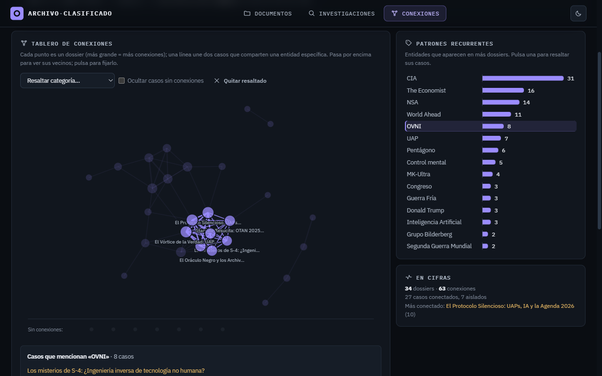

# Agente Info Clasificados

Panel web para consultar **documentos desclasificados** publicados por gobiernos y
organismos oficiales (NARA, FBI Vault, NASA, archive.org y peticiones FOIA de The
Black Vault), con resumen, puntos clave, implicaciones, metadatos y nivel de
confianza por expediente.

Incluye además un **detective conspiranoico autónomo** que investiga por su cuenta
(OVNIs, MK-Ultra, Stargate, portadas de The Economist, etc.) partiendo de Wikipedia y
de los propios documentos oficiales del archivo, separa hechos de especulación y
guarda los dossiers en una sección aparte con imágenes y la calidad de sus fuentes.

> ⚠ Aviso: la sección "Investigaciones" es **especulativa por diseño** — las
> teorías se etiquetan claramente como tales y se separan de los documentos
> oficiales. No es una herramienta de afirmación de teorías sino de análisis.

## Capturas

**Documentos desclasificados** — estadísticas, distribución por categoría, fuente y
década (pulsa una barra para filtrar), buscador sin tildes y filtros compartibles por URL:


**Dossiers del Detective** — investigación autónoma plegable, con imágenes, calidad
de las fuentes, hechos verificados, especulación marcada como tal y veredicto:


**Conexiones** — tablero de casos que comparten entidades, patrones recurrentes y
línea temporal de los años que se mencionan:



## Cómo arrancarlo

Necesitas **Python 3.10+** instalado.

### Windows
Doble clic en **`iniciar.bat`**.

### macOS / Linux
```bash
chmod +x iniciar.sh
./iniciar.sh
```

En los tres sistemas se instalarán las dependencias automáticamente, se creará
`config.py` a partir de la plantilla si aún no existe y se abrirá el navegador en
**http://localhost:5790**. Para detenerlo, `Ctrl + C` en la consola.

### Arranque manual (cualquier sistema)

```bash
pip install -r requirements.txt
copy config.example.py config.py    # (o: cp config.example.py config.py en Mac/Linux)
python app.py        # o python3 app.py en Mac/Linux
```

`config.py` es tuyo, no se sube al repositorio (ver la sección de claves más abajo);
`config.example.py` es la plantilla que sí se versiona.

## Qué hace

- **Tres páginas** con navegación arriba y **tema claro u oscuro** (se recuerda):
  - 📂 **Documentos** — expedientes oficiales desclasificados, paginados.
  - 🕵️ **Investigaciones** — dossiers del detective, plegables.
  - 🕸️ **Conexiones** — qué casos comparten entidades y en qué años se concentran.
- **Buscador** que no distingue tildes ni mayúsculas y exige todas las palabras
  («area 51 roswell»), sobre título, título original, resumen, puntos clave y organismo.
  Tecla `/` para ir a él.
- **Filtros** por fuente, categoría, país, confianza, estado del resumen y fechas
  (también fechas de solo año, como «1947»), con orden elegible. Las opciones salen
  del propio archivo y el estado queda en la URL, así un filtro se puede compartir.
- **Tarjetas expandibles** con resumen, puntos clave, implicaciones, trazabilidad y
  botón para **abrir el documento original**.
- **Estadísticas y gráficas** por categoría, fuente y década; pulsar una barra filtra.
- **Actualización diaria automática** a las 06:00 (configurable), con progreso visible.
- **Resúmenes con IA en segundo plano**: el archivo se resume solo, de poco en poco.
  Antes de gastar una llamada aprovecha el análisis del informe PDF si ya existe, y
  marca como **«sin texto legible»** los escaneados que no se pueden leer, en vez de
  inventar un resumen a partir del título.
- **Informes PDF** por documento y por dossier, con la tipografía de la web,
  cabecera, pie y número de página.
- **Detective autónomo** que investiga solo cada hora, muestra en qué fase va y
  descarta cualquier URL que el modelo cite sin haberla visto.
- **Exportar JSON** con todos los documentos.

## Motor LLM (cerebro de la IA)

Edita `LLM_BACKEND` en `config.py`:

### Opción 1 — OpenRouter (recomendado, en la nube)

1. Crea una clave gratuita en [openrouter.ai/keys](https://openrouter.ai/keys).
2. En `config.py`:
   ```
   LLM_BACKEND = "openrouter"
   OPENROUTER_API_KEY = "tu_clave_aqui"
   OPENROUTER_MODEL = "openai/gpt-oss-120b"   # o cualquier otro modelo de openrouter.ai/models
   ```
3. Reinicia.

No depende de tu CPU: corre en la infraestructura de OpenRouter, así que va mucho
más rápido y fiable que un modelo local. Requiere internet; algunos modelos son
gratuitos, otros tienen coste por token (revísalo en openrouter.ai/models).

La llamada pide JSON estricto (`OPENROUTER_JSON_MODE`), limita el razonamiento de los
modelos que «piensan» para que no se coman el espacio del JSON (`OPENROUTER_REASONING`)
y reintenta sola ante saturación o límite de ritmo (429/5xx).

**PDF escaneados (opcional):** muchos documentos antiguos son imágenes sin capa de
texto. Los de archive.org se leen gratis con su OCR. Para el resto puedes activar un
modelo con visión que lea las primeras páginas como imágenes:
```
OPENROUTER_VISION_MODEL = "google/gemini-2.5-flash-lite"   # ~0,1 céntimos por documento
```
Viene desactivado porque tiene coste. Con él activo aparece el botón
«Leer N escaneados con visión».

### Opción 2 — LM Studio local (sin límites, pero lento en CPU)

1. Instala [LM Studio](https://lmstudio.ai).
2. Descarga y carga un modelo (recomendado: **Qwen3 8B/9B** o **Qwen2.5 7B Instruct**).
3. Pestaña *Developer / Local Server* → **Start Server** (puerto 1234).
4. En `config.py`:
   ```
   LLM_BACKEND = "lmstudio"
   LMSTUDIO_MODEL = "qwen/qwen3.5-9b"   # el id que ves cargado en LM Studio
   ```
5. Reinicia.

Sin límites de uso, 100% privado y gratis. Va bastante más lento sin GPU
(un dossier del detective puede tardar minutos).

### Opción 3 — Gemini (opcional, plan gratuito limitado)

1. Crea una clave gratuita en [aistudio.google.com/apikey](https://aistudio.google.com/apikey).
2. En `config.py`:
   ```
   LLM_BACKEND = "gemini"
   GEMINI_API_KEY = "tu_clave_aqui"
   ```
3. Reinicia.

> 🔐 **Tus claves nunca se suben a GitHub.** `config.py` está en `.gitignore` —
> es tuyo, vive solo en tu máquina. La plantilla sin secretos que sí se sube es
> `config.example.py`. Alternativa: define las claves como variables de entorno
> (`GEMINI_API_KEY`, `OPENROUTER_API_KEY`); el código las lee también de ahí.

## Marcas

| Insignia | Significado |
|----------|-------------|
| **IA** | El resumen lo generó el motor LLM a partir del contenido del documento. |
| **Curado** | Resumen redactado a mano (documentos semilla). |
| **Pendiente** | Aún sin resumen; el archivo lo resumirá solo en segundo plano. |
| **Sin texto** | Escaneado sin capa de texto o fuente que no deja descargar: ábrelo en el original. |
| **Nuevo** | Ingresado hoy. |
| **Confianza alta / media / baja** | Fiabilidad de la fuente y de la información. |

En los dossiers, cada fuente citada se clasifica como **oficial** (.gov, .mil, .gob…),
**archivo documental**, **referencia** (Wikipedia, revistas científicas), **prensa**,
**web** o **redes/vídeo**, para ver de un vistazo en qué se apoya cada caso.

## Estructura del proyecto

```
app.py              Servidor Flask + planificador
config.example.py   Plantilla de configuración (se sube; sin secretos)
config.py           Tu configuración real (no se sube; claves, motor LLM, horarios)
database.py         SQLite (documentos + investigaciones, búsqueda sin tildes, filtros, WAL)
updater.py          Ingestor de fuentes con rotación y fechas reales + actualización en segundo plano
analizador.py       Resúmenes con IA en segundo plano (reaprovecha los informes, detecta ilegibles)
tareas.py           Tareas de fondo con cerrojo y estado (actualización, análisis, detective)
gemini.py           Backend Gemini + descarga de contenido (PDF, OCR de archive.org)
llm.py              Capa intercambiable (Gemini / LM Studio / OpenRouter, visión opcional)
detective.py        Detective autónomo: Wikipedia + noticias + web + archivo oficial
analisis.py         Conexiones entre dossiers y clasificación de fuentes
informe.py          Informes PDF (documentos y dossiers)
templates/
  base.html         Esqueleto común: navegación, tema, tipografía
  index.html        Documentos
  investigaciones.html  Dossiers del detective
  conexiones.html   Tablero de conexiones y línea temporal
static/css/         style.css (tema claro/oscuro con tokens) y fonts.css
static/fonts/       IBM Plex Sans/Mono en local (licencia OFL); ttf/ para los PDF
static/js/
  icons.js          Iconos SVG en línea
  common.js         Utilidades compartidas: API, avisos, gráficas, paginación, tema
tests/              Tests unitarios y de integración (pytest)
data/               (generado, no se sube) base de datos e informes
requirements.txt    Dependencias (requirements-dev.txt: pytest)
iniciar.bat         Arranque rápido en Windows
```

Tests: `pip install -r requirements-dev.txt` y `python -m pytest -q`.

## Fuentes de documentos (todas con PDF descargable)

- **NARA** — registros de los asesinatos de **JFK** (publicaciones de 2023 y 2025),
  **RFK** y **MLK** (2025), los **Papeles del Pentágono** y las listas trimestrales del
  National Declassification Center.
- **NASA** — informe final del estudio independiente sobre UAP (2023).
- **FBI Vault** — archivos desclasificados recientes del FBI.
- **The Black Vault** — documentos entregados vía FOIA por CIA, NSA, Navy, AARO y
  otras agencias (archivo privado de referencia: entran con fiabilidad «media»).
- **archive.org** — MKUltra, Project Blue Book, Stargate, Operation Northwoods,
  Operation Paperclip, Comité Church, COINTELPRO y otros documentos históricos.

Cada fuente aporta **como máximo N documentos nuevos por actualización**. En las
colecciones grandes (miles de PDF en RFK o MLK) eso hace que el archivo crezca cada
día con material distinto. Las fechas son las de publicación o las históricas del
material, no la del día en que se descargó.

Cualquier fuente puede activarse o desactivarse editando las listas en `config.py`.
El ingestor descarta automáticamente cualquier elemento que no se pueda descargar
o que supere el tamaño máximo configurable, y no vuelve a comprobar lo que ya tiene.

## Aviso legal y ético

Este programa trabaja **solo con material publicado oficialmente** o disponible
públicamente en repositorios verificados. No accede a fuentes ilegales ni intenta
desclasificar nada. Si encuentras información personal sensible en algún
documento, márcala antes de redistribuirla.

La sección de investigaciones del detective es **especulativa y de
entretenimiento**: separa cuidadosamente hechos verificables de teorías, pero no
debe usarse como fuente autoritativa.
