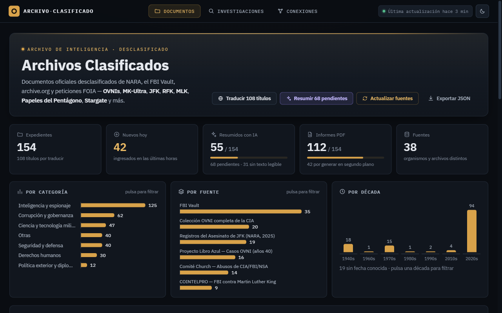
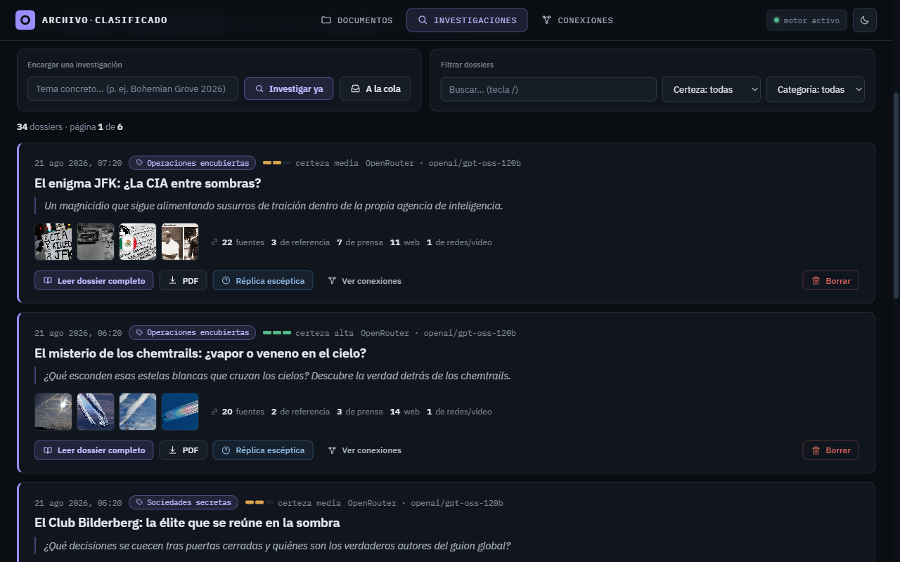

# Agente Info Clasificados

Panel web para consultar **documentos desclasificados** publicados por gobiernos y
organismos oficiales (NARA, FBI Vault, archive.org), con resumen, puntos clave,
implicaciones, metadatos y nivel de confianza por expediente.

Incluye además un **detective conspiranoico autónomo** que investiga en internet
por su cuenta (UFOs, MK-Ultra, Stargate, portadas de The Economist, etc.), separa
hechos de especulación y guarda los dossiers en una sección aparte con imágenes.

> ⚠ Aviso: la sección "Investigaciones" es **especulativa por diseño** — las
> teorías se etiquetan claramente como tales y se separan de los documentos
> oficiales. No es una herramienta de afirmación de teorías sino de análisis.

## Capturas

**Documentos desclasificados** — buscador, filtros, paginación y estadísticas:



**Dossiers del Detective** — investigación autónoma con imágenes, hechos verificados,
especulación marcada como tal y veredicto del analista:



## Cómo arrancarlo

Necesitas **Python 3.10+** instalado.

### Windows
Doble clic en **`iniciar.bat`**.

### macOS / Linux
```bash
chmod +x iniciar.sh
./iniciar.sh
```

En los tres sistemas se instalarán las dependencias automáticamente y se abrirá
el navegador en **http://localhost:5790**. Para detenerlo, `Ctrl + C` en la consola.

### Arranque manual (cualquier sistema)

```bash
pip install -r requirements.txt
copy config.example.py config.py    # (o: cp config.example.py config.py en Mac/Linux)
python app.py        # o python3 app.py en Mac/Linux
```

`config.py` es tuyo, no se sube al repositorio (ver la sección de claves más abajo);
`config.example.py` es la plantilla que sí se versiona.

## Qué hace

- **Dos páginas** separadas con navegación arriba:
  - 📂 **Documentos** — expedientes oficiales desclasificados, paginados.
  - 🕵️ **Investigaciones** — dossiers del detective con imágenes.
- **Buscador y filtros** (categoría, país, confianza, verificación, fechas).
- **Tarjetas expandibles** con resumen, puntos clave, implicaciones y trazabilidad.
- **Estadísticas y gráficas** por categoría y país.
- **Actualización diaria automática** a las 06:00 (configurable).
- **Detective autónomo** que investiga solo cada hora con el motor LLM.
- **Resúmenes con IA** y **generación de informes PDF** por documento.
- **Exportar JSON** con todos los documentos.

## Motor LLM (cerebro de la IA)

Edita `LLM_BACKEND` en `config.py`:

### Opción 1 — OpenRouter (recomendado, en la nube)

1. Crea una clave gratuita en [openrouter.ai/keys](https://openrouter.ai/keys).
2. En `config.py`:
   ```
   LLM_BACKEND = "openrouter"
   OPENROUTER_API_KEY = "tu_clave_aqui"
   OPENROUTER_MODEL = "openai/gpt-oss-120b"   # o cualquier otro modelo de openrouter.ai/models
   ```
3. Reinicia.

No depende de tu CPU: corre en la infraestructura de OpenRouter, así que va mucho
más rápido y fiable que un modelo local. Requiere internet; algunos modelos son
gratuitos, otros tienen coste por token (revísalo en openrouter.ai/models).

### Opción 2 — LM Studio local (sin límites, pero lento en CPU)

1. Instala [LM Studio](https://lmstudio.ai).
2. Descarga y carga un modelo (recomendado: **Qwen3 8B/9B** o **Qwen2.5 7B Instruct**).
3. Pestaña *Developer / Local Server* → **Start Server** (puerto 1234).
4. En `config.py`:
   ```
   LLM_BACKEND = "lmstudio"
   LMSTUDIO_MODEL = "qwen/qwen3.5-9b"   # el id que ves cargado en LM Studio
   ```
5. Reinicia.

Sin límites de uso, 100% privado y gratis. Va bastante más lento sin GPU
(un dossier del detective puede tardar minutos).

### Opción 3 — Gemini (opcional, plan gratuito limitado)

1. Crea una clave gratuita en [aistudio.google.com/apikey](https://aistudio.google.com/apikey).
2. En `config.py`:
   ```
   LLM_BACKEND = "gemini"
   GEMINI_API_KEY = "tu_clave_aqui"
   ```
3. Reinicia.

> 🔐 **Tus claves nunca se suben a GitHub.** `config.py` está en `.gitignore` —
> es tuyo, vive solo en tu máquina. La plantilla sin secretos que sí se sube es
> `config.example.py`. Alternativa: define las claves como variables de entorno
> (`GEMINI_API_KEY`, `OPENROUTER_API_KEY`); el código las lee también de ahí.

## Marcas

| Insignia | Significado |
|----------|-------------|
| ✓ **Oficial** | Confirmado como desclasificado por la fuente oficial. |
| ⚠ **Posible** | Detectado automáticamente; requiere verificación manual. |
| 🤖 **IA** | El resumen lo generó el motor LLM (no curado). |
| 🆕 **NUEVO** | Ingresado hoy. |

## Estructura del proyecto

```
app.py              Servidor Flask + planificador
config.example.py   Plantilla de configuración (se sube; sin secretos)
config.py           Tu configuración real (no se sube; claves, motor LLM, horarios)
database.py         SQLite (documentos + investigaciones, tablas separadas, paginación)
updater.py          Ingestor de fuentes (NARA, FBI Vault, archive.org) + actualización en segundo plano
gemini.py           Backend LLM Gemini (opcional)
llm.py              Capa intercambiable (Gemini / LM Studio / OpenRouter)
detective.py        Detective conspiranoico autónomo + búsqueda web
informe.py          Generación de informes PDF
templates/
  index.html        Página de documentos (paginada en servidor)
  investigaciones.html  Página de dossiers del detective (paginada en servidor)
static/css/
  style.css         Tema visual
static/js/
  icons.js          Sistema de iconos SVG en línea compartido por las dos páginas
tests/               Tests unitarios y de integración (pytest)
data/               (generado, no se sube) base de datos e informes
requirements.txt    Dependencias
iniciar.bat         Arranque rápido en Windows
```

## Fuentes de documentos (todas con PDF descargable)

- **NARA NDC** — listas de publicación trimestrales del National Declassification Center.
- **JFK 2025** — registros del asesinato de JFK publicados por NARA en 2025.
- **FBI Vault** — archivos desclasificados recientes del FBI.
- **archive.org** — MKUltra, Project Blue Book, Stargate, Operation Northwoods,
  Operation Paperclip y otros documentos históricos.

Cualquier fuente puede activarse o desactivarse editando las listas en `config.py`.
El ingestor descarta automáticamente cualquier elemento que no se pueda descargar
o que supere el tamaño máximo configurable.

## Aviso legal y ético

Este programa trabaja **solo con material publicado oficialmente** o disponible
públicamente en repositorios verificados. No accede a fuentes ilegales ni intenta
desclasificar nada. Si encuentras información personal sensible en algún
documento, márcala antes de redistribuirla.

La sección de investigaciones del detective es **especulativa y de
entretenimiento**: separa cuidadosamente hechos verificables de teorías, pero no
debe usarse como fuente autoritativa.
